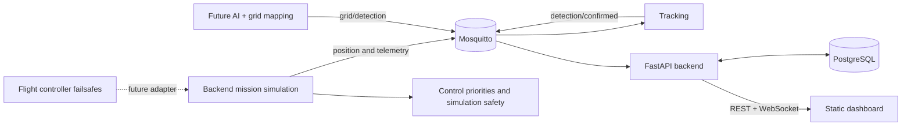

# Grideye

Grideye is an ARM64-friendly, modular bootstrap for indoor grid inspection. It deliberately uses
simulators and typed adapter boundaries. The backend provides mission execution and failsafe
behavior **in simulation only**. Real motor control and flight failsafes remain the flight
controller's responsibility.

## Quick start on Raspberry Pi OS 64-bit

Prerequisites are Git, Docker Engine with Compose v2, and (for host development) Python 3.12+
plus [uv](https://docs.astral.sh/uv/). Docker images used here publish ARM64 variants.

```bash
cp .env.example .env             # replace the example database password
docker compose --env-file .env build
docker compose --env-file .env up -d
curl http://localhost:8000/api/v1/system/health
open http://localhost:8000/docs  # or use a browser on another machine
```

The dashboard is at `http://localhost:8000/`. Run `make ps`, `make logs`, `make smoke`, and
`make down` for common operations. Host-side setup and tests use `make setup`, `make test`, and
`make lint`. Integration tests require the running stack: `make integration`.

Alternatively, use the executable scripts in the project root:

```bash
./start.sh  # build the current code and start all services in the background
./stop.sh   # stop and remove containers; preserve database and MQTT data volumes
```

Both scripts require Docker Compose v2 and a configured `.env` file. They also work
when called by absolute path from another directory. After code changes, run
`./start.sh` again to rebuild and update the services. The dashboard may take a
short time to become available after startup.

On small Pis, the first multi-service build may be memory-heavy because each service references
the same build context; Compose/Docker layer caching avoids rebuilding identical layers. No AI
weights are downloaded.

## Architecture



## API and persistence

OpenAPI is available at `/docs`. The API includes health/services, current position and
telemetry, mission CRUD/state actions, detections, grid cells and configuration reads. The
configuration API validates and atomically persists settings with `PUT /api/v1/config/{name}`.

The dashboard offers an interactive grid, persisted detections and service pages at
`/services/{service}`. Missing heartbeats are unknown; stale heartbeats are offline.
MQTT and database connections are checked from the backend and do not prove hardware connectivity.
Compose mounts the host `config` directory so settings survive container replacement.
Grid, safety, anchor mappings and the heartbeat timeout update immediately. Grid, safety and
anchor changes require an idle, landed simulation. Logging and tracking proximity require
a restart. The old UWB settings apply only to the optional legacy simulator. Camera, AI and
grid-mapping remain future adapters. Mission, UWB and flight simulation run in the backend.
Credentials remain in `.env` / Compose.
Settings edits are shared by dashboard users; the last save wins.
Only missions, confirmed detections and system events are modeled for persistence; high-rate
telemetry stays in memory.

## Mission planning and simulation

The dashboard provides a 2 × 2 m field (A1–J10), a 25 cm flight-zone margin,
graphical routes with four snap modes, persistent mission plans, hover timers and
repeatable flights. Radio and USB takeovers, anchor failures and communication losses
can be tested in the browser. The backend owns priorities, simulation safety and execution.
Real UWB, USB gamepad and MAVLink providers are not implemented yet.
See [the simulation guide](docs/mission_simulation.md) for operation, API and adapter limits.

## MQTT topics

| Area | Topics |
|---|---|
| UWB | `grideye/uwb/position`, `grideye/uwb/status` |
| Flight | `grideye/flight/telemetry`, `attitude`, `battery`, `mode`, `status`, `command`, `command/result` |
| Mission | `grideye/mission/command`, `status`, `progress`, `current_target` |
| Vision | `grideye/camera/status`, `grideye/ai/status`, `grideye/ai/detection`, `grideye/grid/detection` |
| Results | `grideye/detection/confirmed` |
| System | `grideye/system/services/{service}/status`, `grideye/system/events` |

All actual constants live centrally in `grideye_shared.mqtt`. QoS/retain rationale is documented
in [docs/mqtt.md](docs/mqtt.md).

## Hardware extension points

- Implement `UwbProvider` in `services/uwb` for the selected UWB hardware.
- Implement `FlightAdapter` in `services/flight` to encapsulate MAVLink. Never auto-arm or bypass
  flight-controller safeguards.
- Implement `CameraProvider` in `services/camera`; RTSP/GStreamer settings belong in
  `config/camera.yaml`. Images remain outside MQTT.
- Replace `DummyDetector` and `DummyOCR` in `services/ai` without checking model weights into Git.

The current nadir projection only supports roll/pitch zero and a simplified pinhole camera. Full
extrinsics, homography and distortion handling are explicit follow-up work.
